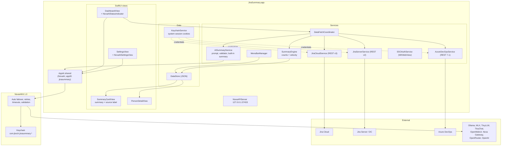
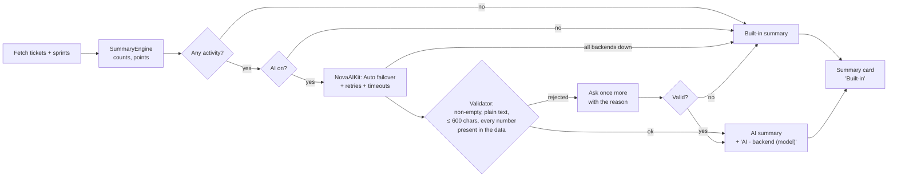

# JiraSummary


A native macOS app that tracks team activity across Jira Cloud, Jira Server/Data Center and Azure DevOps from one
dashboard: per-person ticket counts, sprint velocity, status timelines and a short natural-language summary for
each person. The summary is written by AI when you want it (local or cloud backends through
[NovaAIKit](https://github.com/kochj23/NovaAIKit)) and by a built-in, deterministic summarizer when you don't.

**Version:** 1.3.0 (build 2) | **Bundle ID:** `com.jordankoch.JiraSummary` | **Changelog:** [CHANGELOG.md](CHANGELOG.md)


---

## Contents

- [Features](#features)
- [Architecture](#architecture)
- [AI](#ai)
- [Requirements](#requirements)
- [Installation](#installation)
- [Usage](#usage)
- [Supported systems](#supported-systems)
- [Local HTTP API](#local-http-api)
- [Building from source](#building-from-source)
- [Tests](#tests)
- [Security](#security)
- [Troubleshooting](#troubleshooting)
- [Project structure](#project-structure)
- [License](#license)

---

## Features

- **Multi-system dashboard** - any mix of Jira Cloud, Jira Server/Data Center and Azure DevOps connections,
  fetched in parallel and shown together.
- **SSO sign-in** - an embedded WKWebView handles Okta / Azure AD / SAML; only the resulting session cookie is kept,
  in the Keychain. No passwords are stored.
- **Per-person summary cards** - tickets touched, completed, in progress, blocked and created for a daily, weekly,
  sprint or monthly window, plus sprint points committed vs. completed.
- **Activity summaries** - 2-3 sentences per person, from AI or the built-in summarizer, with a label saying which
  ("AI · Ollama (qwen3:8b)" or "Built-in").
- **Drill-down** - sortable ticket table, status-transition timeline, sprint velocity charts (Swift Charts, last 8
  sprints).
- **AI status indicator** - a dot + label in the dashboard header (and a dot on the person detail view): green when a
  backend answers, orange when none does, grey when AI is off. Click to re-check.
- **Menu bar item** - completed / in progress / blocked counts, last refresh, refresh and open-window actions.
- **Auto-refresh** - 15 min to 2 h, or manual.
- **Local HTTP API** on `127.0.0.1:37433` for local automation.
- **Glassmorphic dark theme** with SF Rounded typography.

---

## Architecture



### Summary pipeline



---

## AI

JiraSummary uses [NovaAIKit](https://github.com/kochj23/NovaAIKit) 1.0 for everything AI. It has no AI client code of
its own.

**Settings > AI** (the standard `NovaAISettingsView`):

- **Use AI** on/off. Off = the built-in summarizer only; nothing is sent anywhere.
- **Backend**: Auto (first reachable, in order), Ollama, MLX, TinyLLM, TinyChat, OpenWebUI, Nova Gateway, OpenRouter,
  OpenAI.
- Per backend: editable URL, model picker (lists the server's models), API key field where one applies.
- Timeout, and a **Test connection** button.

| Feature | AI does | When AI is off, down, or its reply is rejected |
|---|---|---|
| Person activity summary | Writes 2-3 sentences from the counts, sprint points and up to 5 recent tickets | Built-in summary: "*Name* touched N tickets in *System* this week: X completed, Y in progress, Z blocked, W created. *Sprint*: a of b points completed. Most recent: *KEY* (*status*)." |

**Validation.** A reply must be non-empty, plain text, at most 600 characters, and every number in it must appear in
the activity data sent (no invented counts or points). A rejected reply is retried once with the reason, then the
built-in summary is used. Each summary shows where it came from.

**Failover.** Auto tries every configured backend in order with per-request timeouts and retries for transient
errors (5xx, 429, dropped connections); a backend that just failed is skipped for a minute.

**Keys.** API keys live only in the macOS Keychain under `com.jkoch.jirasummary.openrouter` and
`com.jkoch.jirasummary.openai`. The settings view shows "stored", never the key. Keys are only ever sent over https.
Cloud backends join Auto only when a key is stored.

**Privacy.** A summary request contains the person's display name, the system name, counts and recent ticket titles.
Use a local backend (Ollama, MLX, TinyLLM, TinyChat, OpenWebUI, Nova Gateway) to keep that on your network.

**Upgrading from 1.2.x.** On first launch, the old settings are imported (backend, URLs including Nova Gateway,
Ollama and OpenRouter models, on/off); the OpenAI key is moved from `com.jordankoch.JiraSummary` to
`com.jkoch.jirasummary.openai`; the OpenRouter key shared with AIStudio is copied (the original stays); stored
Google Cloud, Azure, AWS and IBM Watson secrets are deleted from the Keychain and UserDefaults. Those four backends
were removed, as were the per-app temperature/max-tokens sliders, usage statistics and the in-app load balancer
(NovaAIKit's Auto failover replaces it).

---

## Requirements

- macOS 14.0 (Sonoma) or later
- Optional, for AI summaries: any one backend above. Quickest: `brew install ollama && ollama pull qwen3:8b && ollama serve`
- Building: Xcode 16+ and XcodeGen (`brew install xcodegen`)

---

## Installation

Open `JiraSummary-v1.3.0-build2.dmg` and drag **JiraSummary** onto **Applications**. The build is ad hoc signed for
local use; on first launch, right-click > Open if Gatekeeper asks.

---

## Usage

1. **Systems** > Add System: pick Jira Cloud, Jira Server or Azure DevOps, enter the base URL, sign in through SSO.
2. **People** > search a connected system and add team members.
3. **Dashboard**: pick a period (daily / weekly / sprint / monthly) and click **Refresh**. Each card shows counts,
   velocity and the activity summary with its source.
4. Click a card for the ticket table, timeline and sprint charts.
5. **Settings**: refresh interval, default period, menu bar item, and AI.

---

## Supported systems

| System | API | Auth | Data |
|---|---|---|---|
| Jira Cloud | REST v3 | session cookie | JQL search, changelogs, sprints, boards, user search |
| Jira Server / Data Center | REST v2 | session cookie | JQL search, changelogs, sprints, boards, user search |
| Azure DevOps | REST 7.1 | session cookie | WIQL, work item updates, iterations, team members |

JQL and WIQL inputs are escaped before they go into a query.

---

## Local HTTP API

Bound to `127.0.0.1:37433` only.

```bash
curl http://127.0.0.1:37433/api/ping
curl http://127.0.0.1:37433/api/status    # app, version, port, uptime
```

---

## Building from source

```bash
git clone git@github.com:kochj23/JiraSummary.git
cd JiraSummary
xcodegen generate                      # project.yml is the source of truth
xcodebuild -project JiraSummary.xcodeproj -scheme JiraSummary -configuration Release build
```

The only package dependency is NovaAIKit (`https://github.com/kochj23/NovaAIKit.git`, from 1.0.0), resolved by
Xcode. The version lives in `project.yml` (`MARKETING_VERSION`, `CURRENT_PROJECT_VERSION`). Release builds have zero
compiler warnings.

The `JiraSummary Widget/` sources are kept in the repo but are not a target in `project.yml` today.

---

## Tests

```bash
xcodebuild test -project JiraSummary.xcodeproj -scheme JiraSummary
```

141 tests, all passing. All fixtures are synthetic; AI tests use an in-memory settings store, an in-memory key store
and a stub `URLProtocol`, so nothing reaches the real Keychain or network.

| Category | Suites | Tests |
|---|---|---|
| Security | `AIKitSecurityTests`, `SecurityTests` | 5 + 20 |
| Performance | `AIKitPerformanceTests` | 2 |
| Retry | `AIKitRetryTests` | 3 |
| Unit | `AIKitUnitTests`, `JiraModelTests`, `AzureDevOpsModelTests`, `TicketActivityTests`, `PersonSummaryTests`, `SprintDataTests`, `SystemConnectionTests`, `TrackedPersonTests` | 6 + 74 |
| Integration | `AIKitIntegrationTests`, `IntegrationTests` | 3 + 8 |
| Functional | `AIKitFunctionalTests`, `SummaryEngineTests` | 4 + 12 |
| Frame / UI state | `AIKitFrameTests` | 4 |

The AI suites cover: AI off and offline fallbacks (nothing sent), retry on 5xx, re-ask on a rejected reply, fallback
after two rejections, the validator (empty, too short, invented numbers, length cap), Keychain service names, legacy
Keychain/UserDefaults migration and its idempotency, no key over plain http, no old AI client left in the sources,
status indicator states, and view rendering.

---

## Security

- System session cookies: Keychain (`com.jordankoch.JiraSummary`), `WhenUnlockedThisDeviceOnly`.
- AI keys: Keychain only (`com.jkoch.jirasummary.*`), https only, never logged or shown. 1.3.0 removes the plaintext
  Google/Azure/AWS/IBM secrets older versions could leave behind.
- No inbound network exposure; the local API listens on loopback only.
- Not sandboxed (network client entitlement).

See [SECURITY.md](SECURITY.md).

---

## Troubleshooting

| Symptom | Fix |
|---|---|
| Cards say "Built-in" | AI is off, or no backend answered. Check the status dot; open Settings > AI and use Test connection. |
| Status dot orange | No backend reachable. Start Ollama (`ollama serve`) or set a URL / key in Settings > AI. |
| Cloud backend never used | Store its key in Settings > AI; keyed backends join Auto only with a key. |
| SSO doesn't finish | Check the base URL (https), then sign in again from Systems. |
| No data after refresh | Check each person's ID type: accountId (Jira Cloud), username (Jira Server), email (Azure DevOps). |

---

## Project structure

```
JiraSummary/
  AI/AppAI.swift                 The app's NovaAI instance + one-time legacy migration
  Services/
    AISummaryService.swift       Prompt, validator, built-in summary
    SummaryEngine.swift          Counts and velocity
    DataFetchCoordinator.swift   Parallel fetch, then summaries
    JiraCloudService.swift / JiraServerService.swift / AzureDevOpsService.swift
    KeychainService.swift        System session cookies
    SSOAuthService.swift, DataStore.swift, MenuBarManager.swift, WidgetDataSync.swift
  Models/                        SystemConnection, TrackedPerson, TicketActivity, PersonSummary, SprintData, API types
  Views/                         Dashboard, People, Activity, Systems, Settings, Sidebar
  Design/ModernDesign.swift      Glass design system
  NovaAPIServer.swift            Loopback HTTP API
JiraSummaryTests/                141 XCTest cases (AIKitAdoptionTests.swift = AI contract)
project.yml                      XcodeGen spec
```

---

## License

MIT - see [LICENSE](LICENSE). Copyright (c) 2026 Jordan Koch.

> This is a personal project created on personal time. It is not affiliated with, endorsed by, or representative of
> any employer.
